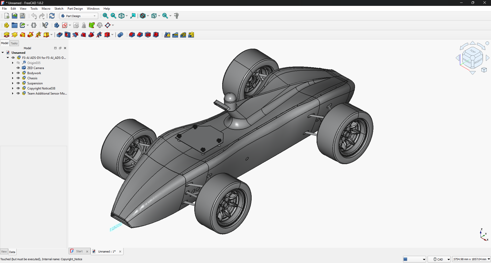
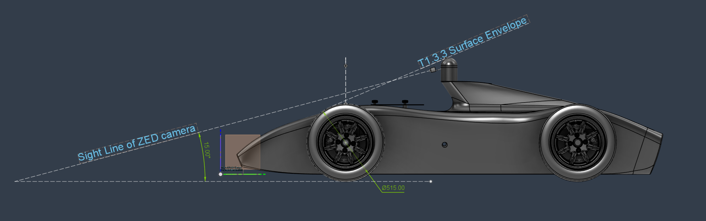
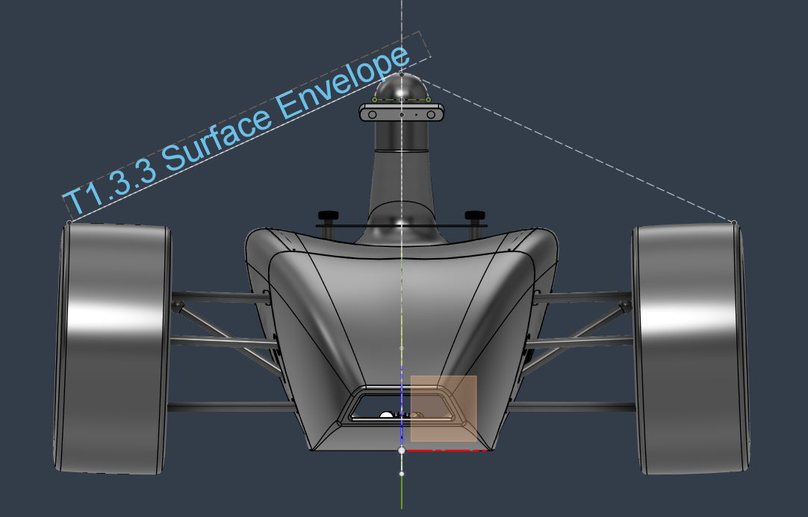
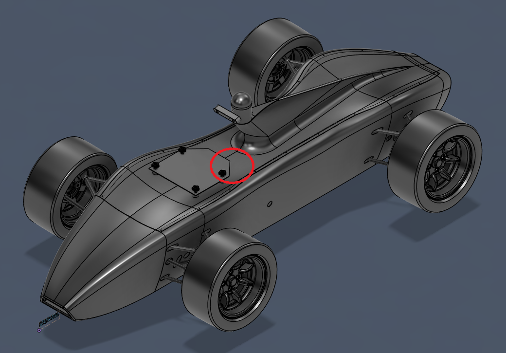
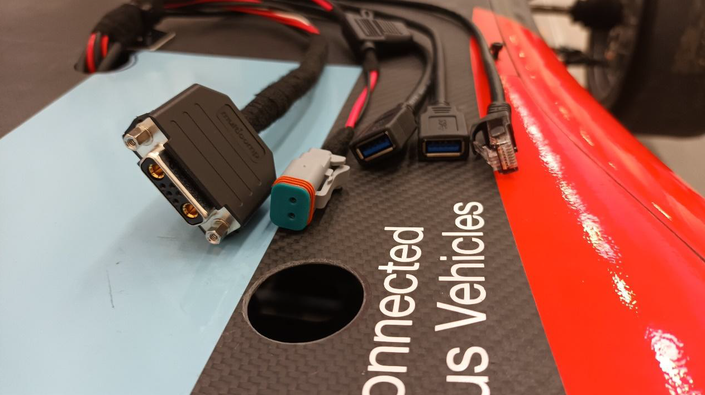
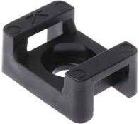
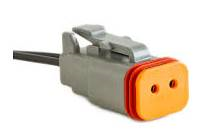
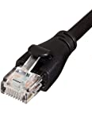
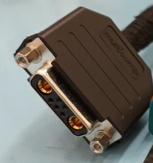

# FS-AI_ADS-DV_CAD

## Introduction

This repository contains CAD data for the IMechE FS-AI ADS-DV for release to participating teams.

The CAD provided is a subset of the whole vehicle CAD and is intended for sensor and / or compute hardware installation and vehicle dynamics modelling purposes.

In particular teams wishing to fit additional sensors and / or compute hardware to a shared IMechE ADS-DV must use this CAD data to gain approval for their installation design. (See section 'Additional Sensor and Compute Mounting CAD Submission and Approval' below).

This CAD data remains Copyright IMechE 2020 and must not be uploaded to alternate public access web / cloud locations. This is both to protect copyright and to ensure there is one 'official' source for CAD data that may be up-issued by the IMechE as necessary. Local clones are encouraged to make it easy for updates to be pulled from the upstream repository using Git.

The URL for this repository is: https://github.com/FS-AI/FS-AI_ADS-DV_CAD

If you are not accessing this repository directly from this URL then likely you are working from a fork or clone which may not contain the latest data or information. If you have made a local clone, please ensure you do a 'git pull' to ensure you have the latest version of all files.

## Updates

The repository will be updated regularly in response to questions and as new information is confirmed and released. Github allows you to 'Watch' the repository so as to be informed of activity.

#### Update 2023-02-23

Clarified that both additional sensor and compute installations are allowed.

#### Update 2021-06-02

CAD models of the various connector types have been added.

#### Update 2026-01-26

The 'f3d' and 'step' files have been updated to the ADS-DV 2026 specification with **provided Sensor Mount Posts, M6 Threaded Rods and 'Quick-Release' Clamping Knobs.**

## Questions

Please use the Github 'Issues' feature to ask questions regarding this repository. Please label your issue with the tag 'question'.

Best efforts will be made to answer all questions but please allow a few days for a response.

If a general forum style chat is more appropriate, please use the Github 'Discussions' feature.

## Content

The repository consists of the following files:

- 'Readme.md' - this file containing information about the repository.
- '\images' - folder containing the images for 'Readme.md'.
- 'FS-AI_ADS-DV_CAD_2026.f3d' - see below.
- 'FS-AI_ADS-DV_CAD_2026.step' - see below.
- '12V_Power_Mated' .f3d & .step' (added 2021-06-02)
- 'RJ45_Ethernet'  .f3d & .step' (added 2021-06-02)
- 'USB_Mated'  .f3d & .step' (added 2021-06-02)

### Fusion 360 File 'FS-AI_ADS-DV_CAD_2026.f3d'

This file is provided in native Fusion 360 format, which means it preserves sketch details, section analysis details and other useful data such as construction geometry.

Fusion 360 is available free-of-charge for non-commercial or educational use. Full details at: https://www.autodesk.co.uk/products/fusion-360/personal

See also this video for information on how to correctly activate the Personal edition of Fusion 360 instead of the 30 day free trial: https://www.youtube.com/watch?v=qJABXBvuoB4&ab_channel=DesktopMakes

### STEP File 'FS-AI_ADS-DV_CAD_2026.step'

This file is a STEP format export of the Fusion 360 file. STEP is a universal file format for import into other CAD packages.

One disadvantage of the STEP format is that it does not preserve the sketch details of the Front and Side view relating to the Surface Envelope definition and the ZED camera sight line. You will need to replicate this sketch geometry within your own CAD package. See the images below.

This STEP file has been tested with FreeCAD v1.0.2, available here: https://www.freecad.org/

**STEP as rendered in FreeCAD v1.0.2, without Front & Side View Sketches:**

## Front and Side Sketch Views

### Side View

In the case of using the STEP file, see below for the details of the sight line of the ZED camera and the FS-AI Rule T 1.3.3 Surface Envelope in side view.

The ZED camera reference angle is 15deg below horizontal. A normal line projected from the centre of the front face of the ZED camera will intersect the ground plane approximately 2750mm from the camera position.

FS-AI Rule T 1.3.3 defines a 'Surface Envelope' in side view from the top of the ADS-DV TSAL to the outer profile of the tyres. Rule T 1.3.3 further requires that all sensors and / or compute hardware be located within this surface envelope. Since the ADS-DV does not have a traditional roll hoop, the envelope is defined from the outer profile of the TSAL dome. The tyre profile is projected as a 515mm diameter circle on the vehicle centreline.

### Front View

In the case of using the STEP file, see below for the details of the Rule T 1.3.3 Surface Envelope in front view.

FS-AI Rule T 1.3.3 defines a 'Surface Envelope' in front view from the top of the ADS-DV TSAL to the outer profile of the tyres. Rule T 1.3.3 further requires that all sensors and / or compute hardware be located within this surface envelope. Since the ADS-DV does not have a traditional roll hoop, the envelope is defined from the outer profile of the TSAL dome instead. The tallest point on the tyre profile is used.

## Additional Sensor and Compute Mounting

Teams wishing to mount additional sensors and / or compute hardware to the ADS-DV must adhere to the following requirements:

### Surface Envelope (FS-AI Rules T 1.3.3)

Additional Sensors, Compute hardware and all mounting hardware **must** fit within both the Side View and Front View Surface Envelopes defined above.

**NOTE:** FS-AI Rule T 1.3.4 prohibits teams using a **shared** IMechE ADS-DV from using the 700mm x 500mm forward sensor zone.

### Mounting Requirements (Updated for 2026)

The nominal reference design for an Additional Sensor and Compute Mounting is a Sensor Plate placed 100mm up from the internal chassis on the provided Spacer Posts.

M6 threaded rods are now provided, similar to the Reference Compute Installation at the rear of the vehicle. These M6 threads accept a 'Quick Release' Clamping Knob, RS Part number 188-3461.

An example plate is provided in the CAD data. The example uses all 4 available mounting locations, **the centre location has been removed for 2026**.

To safely and securely mount additional sensors the following requirements must be respected:

- **At least 3** mounting pillar locations **must be used**, out of the 4 available.
- M6 Clearance holes are needed in the Sensor Plate. 6.5mm diameter holes are recommended.
- Clearance is needed for the 40mm diameter 'Quick Release' Clamping Knobs.
- Maximum 5mm Sensor Plate thickness.

## Additional Sensor Electrical Connections

The electrical connector location for additional sensors is somewhat flexible. The approximate location is in the region circled on the image below:

The wiring harness on the vehicle side will allow for a range of movement within this approximate zone. Connecting and disconnecting will be done by moving the vehicle side wiring harness. However additional sensor and compute hardware mounting designs **must allow for strain relief of both sides of the connected wiring**. The strain relief on the vehicle side of the connector(s) should be adjustable for cable diameter and easily removeable. A screwed down cable tie base is the recommended option:

### Vehicle Side Connectors

The vehicle side connectors are described below. All images are **vehicle side connector** you need to supply and fit the **opposite mating connector** to your additional sensor installation.

#### Power

- 1x TE DT06-2S power connector supplying automotive ‘12V’ (11.5 ->14.5V depending on battery charge state) up to 5A. Pin 1 = 12V and Pin 2 = Gnd:

Mating part number TE DT04-2P.

#### Ethernet

- 1x Ethernet Cat5e cables with the standard RJ45 connector running to the rear of the vehicle for use by the InCarPC or a Team compute platform:

#### USB3.0

- 2x USB3.0 Type A sockets running to the rear of the vehicle for use by the InCarPC or a Team compute platform:

#### Compute Platform Power & CAN

- 1x D-Sub connector for Power & CAN on the vehicle.

**For full Mating Part Number and Pinout details see the info from the 'FS-AI/FS-AI_Compute' GitHub repository at [LINK](https://github.com/FS-AI/FS-AI_Compute/blob/master/ADS-DV_Reference_Compute_Installation.md)**

## Additional Sensor and Compute Mounting CAD Submission for Approval

Teams wishing to fit additional sensors and / or compute hardware to a shared IMechE ADS_DV **must submit CAD data** of their proposed design for approval. Teams should have requested additional sensors and / or compute hardware on their 'DCS' form with full details provided for review in their 'ASF' document. Team leaders will be contacted by email with details of this process and contact details for submission. A 'zip' archive should be used to contain all data, labelled with team identification and a version number.

The CAD data should place the sensor and / or compute hardware mounting design in the correct position **within the CAD data provided in this repository** and include the following components / information:

- All additional sensor and compute hardware (space-claim / box models are fine, internal detail is not required).
- Sensor mounting structural components **including the provided spacer tubes, M6 threaded rods and 'Quick Release' clamping knobs.**
- All fasteners used to mount sensor and compute hardware, or a description of the mounting technique used (e.g. 3M Dual Lock).
- Information on component materials and manufacturing process.
- Information and / or models regarding the proposed wiring scheme, connector location(s) and the **cable strain relief implementation**.

CAD data file format should be either native Fusion 360 ('.f3d') or STEP ('.stp' / '.step').

Supplementary information should be provided as either a PDF or Markdown file.

----
Don't forget to check the IMechE website regularly for documentation updates:

https://www.imeche.org/events/formula-student/team-information/forms-and-documents

## For specific questions and bug reports, please raise an Issue and tag it with the 'question' label.
#### Otherwise, please use the Github Discussions feature for general forum-style chat.
